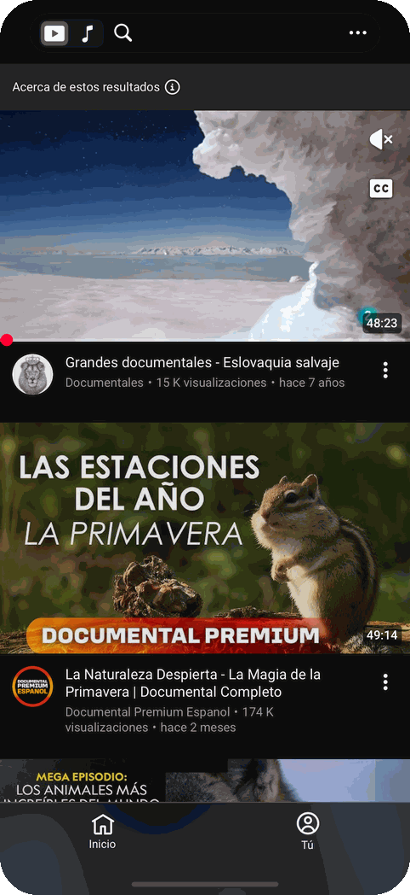
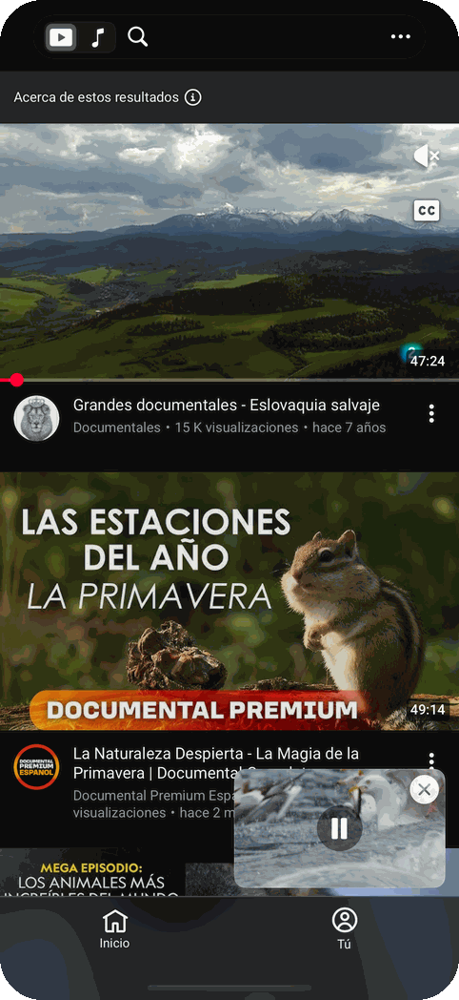
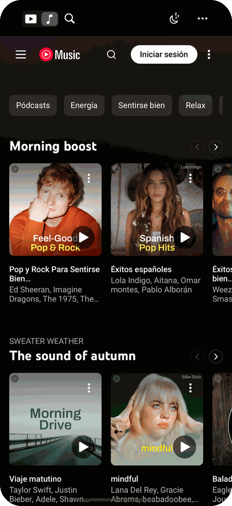
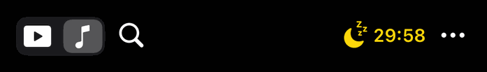
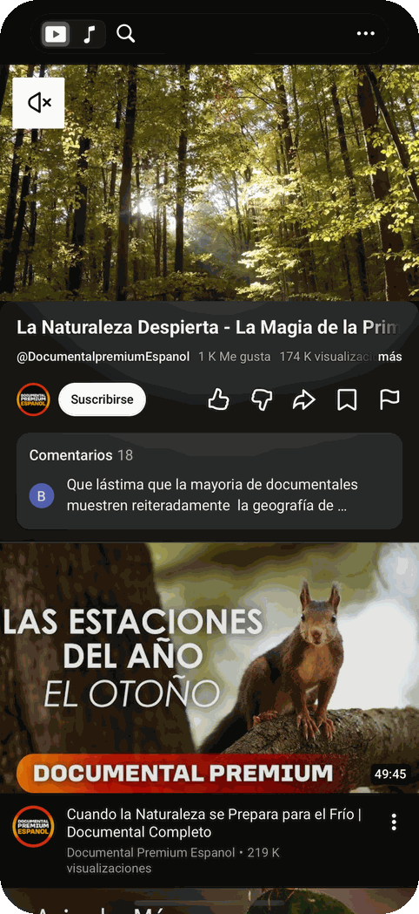
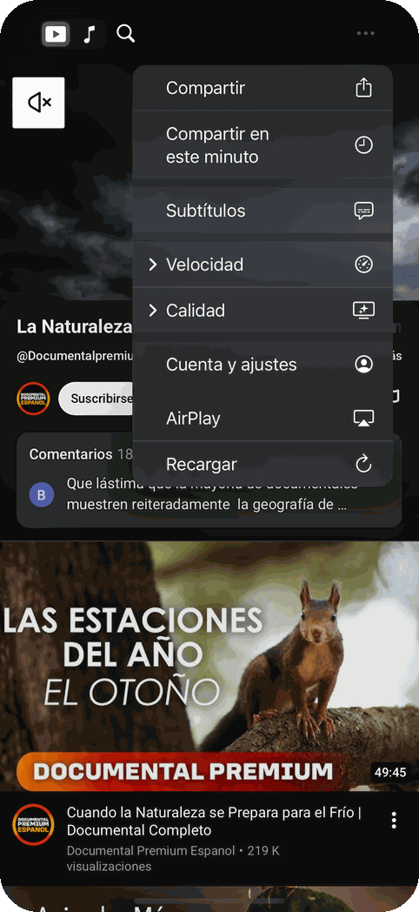
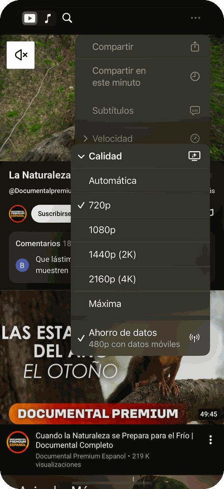
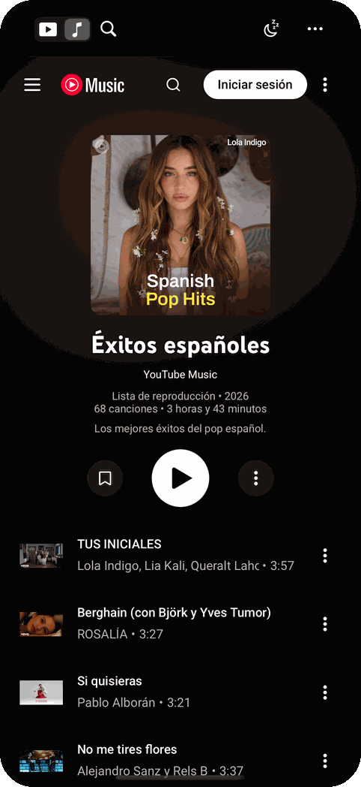
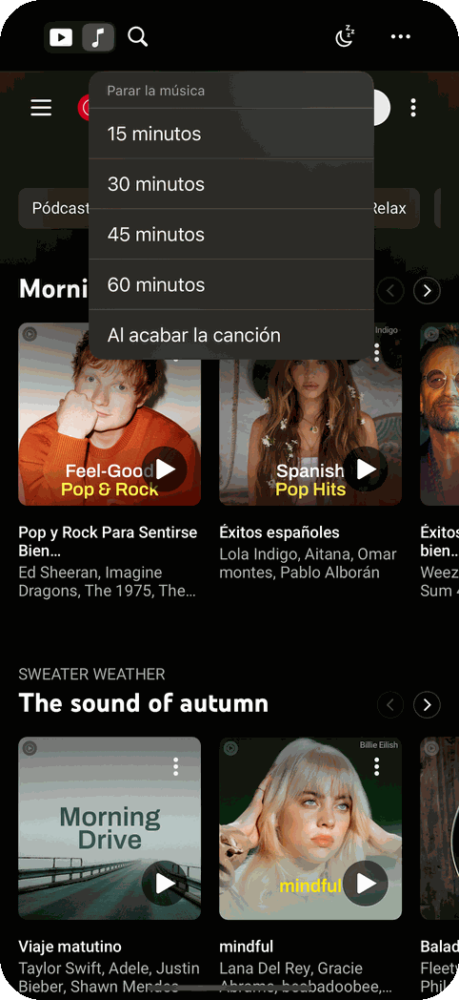
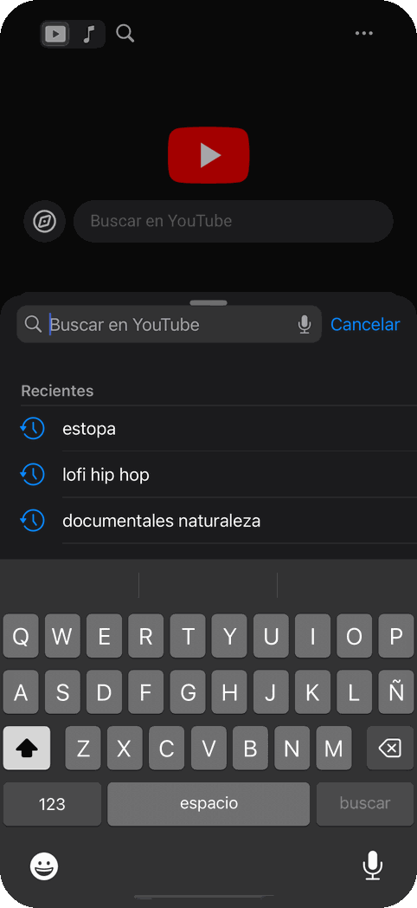

# Tube

**YouTube y YouTube Music en el iPhone, sin anuncios, en una sola app.**

Tube abre YouTube y YouTube Music a pantalla completa, con el bloqueo de anuncios de Brave Shields, audio en segundo plano y una cápsula junto a la isla dinámica que hace de barra de navegación. No es una app de la App Store: la compilas e instalas tú en tu iPhone con tu Apple ID, gratis.

<p align="center">
  
  
  
</p>

> **Proyecto personal, sin relación con YouTube ni Google.** Se compila e instala en tu propio iPhone; no se distribuye en la App Store. Bloquear anuncios o reproducir en segundo plano puede ir contra las condiciones de uso de YouTube: úsalo bajo tu responsabilidad. Si quieres apoyar a los creadores, YouTube Premium es la vía oficial.

## La cápsula

<p align="center">
  
</p>

En lugar de las cabeceras de YouTube y Music, una cápsula negra amplía la isla dinámica a los dos lados:

- **▶︎ ♪** cambia de pestaña. Las dos siguen vivas, así que cambiar no recarga ni corta la música. Tocar la pestaña en la que estás vuelve a su inicio; mantener ♪ reanuda la última canción.
- **🔍** abre el buscador. Mantenerlo pulsado busca por voz.
- **☾** (solo en Music) es el temporizador para dormir, con la cuenta atrás en la propia cápsula.
- **⋯** abre el menú: compartir, subtítulos, velocidad, calidad, cuenta, AirPlay y recargar.

En iPhone sin isla dinámica, la cápsula aparece como una barra arriba con los mismos botones.

## YouTube

<p align="center">
  
  
  
</p>

- **Sin anuncios**: los mismos filtros que Brave y uBlock Origin. Si alguno se cuela, se silencia y se salta solo.
- **SponsorBlock**: salta patrocinios, autopromoción y recordatorios de «suscríbete», con un aviso. Solo se envía un prefijo del hash del vídeo.
- **Sin Shorts** en la portada, las búsquedas ni la barra inferior. Un enlace a un Short se abre como vídeo normal.
- **Minirreproductor como en la app oficial**: los vídeos se abren en un reproductor encima de la lista, así la lista nunca se recarga. Arrastra el vídeo hacia abajo y sigue sonando en una ventanita que puedes mover a donde quieras. Tócala para volver, usa el botón central para pausar, o la × (o lánzala a la derecha) para cerrarla.
- **Calidad hasta 4K60 HDR** sin Premium, con la opción *Máxima*. Por defecto 720p.
- **Ahorro de datos**: con datos móviles o en Modo de datos reducidos, los vídeos van a 480p; con wifi, a la calidad elegida. Cambia solo, también a mitad de vídeo.
- **Pantalla completa al girar** el iPhone; al ponerlo vertical vuelve, y el vídeo sigue sonando.
- **Subtítulos** apagados por defecto, también en las vistas previas. Se activan en ⋯ y se recuerda.
- **Compartir en el minuto exacto** con un enlace `youtu.be` limpio.
- **Imagen en imagen** y **AirPlay**.

## YouTube Music

<p align="center">
  
  
</p>

- **Audio con el iPhone bloqueado**, con carátula en la pantalla de bloqueo y botones de **siguiente / anterior** en lugar de los saltos de 10 segundos.
- **Gestos en el reproductor**: desliza la carátula a los lados para cambiar de canción, tócala para ver la letra en grande y deslízala hacia abajo para minimizar.
- **Temporizador para dormir**: 15, 30, 45 o 60 minutos, o al acabar la canción.
- **Sin avisos de Premium** ni botones de «Abrir aplicación».
- Recibe el mejor audio gratuito de YouTube (Opus, formato 251). El de 256 kbps es solo para Premium.

## Más cómodo

<p align="center">
  
</p>

- **Buscador propio**, a dos tercios de pantalla, con búsquedas recientes y micrófono.
- **Recuerda dónde estabas**: al abrir vuelve a la pestaña, la página y el segundo exacto del vídeo o la canción, en pausa.
- **Volver atrás** con el gesto del borde izquierdo. Si no hay página anterior, vuelve a la última búsqueda o al inicio.
- **Vibración suave** al tocar, **deslizar hacia abajo para recargar** y una pantalla **«Sin conexión»** que se recarga sola al volver internet.
- **Siri y Atajos**: «Oye Siri, pon mi música en Tube», «Abre Music en Tube», «Temporizador de Tube».
- **Accesos rápidos**: mantén pulsado el icono para abrir Music o YouTube.
- Inicias sesión en Google una vez y vale para las dos pestañas.

## Instalación

Necesitas un Mac con **Xcode** (gratis en la App Store del Mac) y tu Apple ID normal. No hace falta pagar.

### Opción A: desde Xcode

La firma gratuita dura **7 días**; para no tener que repetir el paso 6, activa la renovación automática (más abajo).

1. Descarga el proyecto y abre `TubeShell.xcodeproj`.
2. En Xcode › Ajustes › Cuentas, añade tu Apple ID si no está.
3. Indica tu equipo de firma: crea en la carpeta del proyecto un archivo `Local.xcconfig` (no se sube a git) con
   ```
   DEVELOPMENT_TEAM = TU_ID_DE_EQUIPO
   ```
   El ID está en Xcode › Ajustes › Cuentas › tu Apple ID (Personal Team). Si Xcode dice que el **Bundle Identifier** ya existe, cámbialo por algo tuyo, por ejemplo `es.tunombre.tube`.
4. Conecta el iPhone por cable y desbloquéalo. La primera vez, activa en el iPhone **Ajustes › Privacidad y seguridad › Modo de desarrollador** y reinicia.
5. Arriba en Xcode, elige tu iPhone como destino.
6. Pulsa **▶ (Run)**.
7. Si el iPhone dice «Desarrollador no fiable»: **Ajustes › General › VPN y gestión de dispositivos** › tu Apple ID › **Confiar**.

### Renovación automática desde el Mac

`renew.sh` vuelve a firmar e instalar la app antes de que caduque. Una tarea de launchd lo ejecuta cada hora: cuando quedan menos de 2 días, pide a Apple un perfil nuevo de 7 días, compila e instala. El iPhone tiene que estar conectado por cable o en la misma wifi, y el Mac encendido. Si el último día no lo encuentra, avisa con una notificación.

Indica tu iPhone en un archivo `renew.local` (no se sube a git):

```bash
xcrun devicectl list devices
```

```bash
echo 'DEVICE=TU_IDENTIFICADOR' > renew.local
```

```bash
./renew.sh --install-agent
```

`./renew.sh --force` renueva al momento y `./renew.sh --remove-agent` lo desactiva. El registro está en `~/Library/Logs/TubeShell-renew.log`.

### Opción B: SideStore o AltStore

Instala [SideStore](https://sidestore.io) o [AltStore](https://altstore.io), genera el IPA sin firmar con `./make_ipa.sh` y ábrelo con ellos en el iPhone. Ellos se encargan de renovar la firma cada semana. Con una cuenta gratuita puedes tener hasta 3 apps instaladas así.

## Cuando vuelvan a aparecer anuncios

YouTube cambia su web de vez en cuando. Todo el bloqueo está en `TubeShell/Resources/`:

- **`Shields.js`**: los scripts. Es el que habrá que tocar casi siempre.
- **`ContentRules.json`**: las reglas de red.

Para inspeccionar la app desde el Mac, activa en Safari **Ajustes › Avanzado › Mostrar funciones para desarrolladores web** y, con el iPhone conectado y la app abierta, abre **Desarrollo › tu iPhone › m.youtube.com** (o music.youtube.com).

Las reglas de referencia son las de la [lista de Brave para iOS](https://github.com/brave/adblock-lists/blob/master/brave-lists/brave-ios-specific.txt) y los [quick-fixes de uBlock Origin](https://github.com/uBlockOrigin/uAssets/blob/master/filters/quick-fixes.txt).

## Cómo está hecho

Una app UIKit con dos `WKWebView` (más una tercera para el reproductor de YouTube) que cargan las webs móviles oficiales. `Shields.js` se inyecta al inicio de cada página para quitar los anuncios de los datos antes de que el reproductor los vea, ocultar elementos y añadir las funciones de la cápsula. La parte nativa añade la cápsula, el minirreproductor, el buscador, Siri y la sesión de audio.

```
TubeShell/
├── AppDelegate.swift          Sesión de audio (segundo plano)
├── SceneDelegate.swift        Ventana y accesos rápidos
├── Shortcuts.swift            Atajos de Siri
├── AppTab.swift               Las dos pestañas, sus direcciones y las claves guardadas
├── MainViewController.swift   Cápsula, pestañas y temporizador
├── MainViewController+Player.swift  Reproductor de YouTube y minirreproductor
├── MainViewController+Menus.swift   Menús de la cápsula (⋯, velocidad, calidad, compartir)
├── SearchViewController.swift Buscador propio, con voz
├── WebTab.swift               Vista web configurada como Brave, enlaces, sin conexión
├── ContentRules.swift         Compila las reglas de red (en caché)
├── Info.plist                 Audio en segundo plano, accesos rápidos, micrófono
├── Assets.xcassets            Icono
└── Resources/
    ├── Shields.js             Bloqueo de anuncios y funciones de página
    └── ContentRules.json      Bloqueo de red
make_ipa.sh                    Genera el IPA para SideStore/AltStore
renew.sh                       Renueva la firma cada semana (launchd)
Signing.xcconfig               Lee tu equipo de firma de Local.xcconfig
```

## Problemas conocidos

- **Google no deja iniciar sesión**: la app se identifica como Safari, que suele bastar. Si aun así lo rechaza, inicia sesión desde la otra pestaña.
- **Un anuncio suena entero**: si va incrustado en la propia canción, no se puede saltar sin saltarse la canción, así que solo se silencia.
- **Algo se ve descolocado**: YouTube cambia su web y algunos ajustes de diseño dependen de ella. Abre una incidencia con una captura.

## Licencia

[MIT](LICENSE). Las técnicas de bloqueo se basan en las listas públicas de Brave y uBlock Origin; SponsorBlock usa la API pública de [sponsor.ajay.app](https://sponsor.ajay.app). Las capturas son del simulador de iOS, sin cuenta iniciada.
